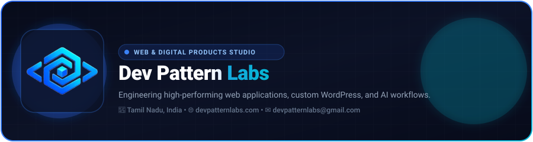

<div align="center">

  

  <br />
  <br />

  [](https://devpatternlabs.com)
  [](https://dpls-web-animation.vercel.app)
  [](mailto:devpatternlabs@gmail.com)
  [](https://devpatternlabs.com)

</div>

---

### 🏛️ About Dev Pattern Labs

**Dev Pattern Labs** is an independent web development and technology studio based in **Tamil Nadu, India**. We help businesses turn ideas, outdated websites, and complex operational challenges into modern, scalable digital solutions.

We don't build generic template sites — we engineer maintainable digital assets focused on **business clarity, sub-second page performance, and organic conversion**.

---

### 🛠️ Core Capabilities & Technology Stack

| Capability | Focus & Technologies | Key Deliverables |
| :--- | :--- | :--- |
| **🖥️ Modern Web Development** | **Next.js 15, React 19, TypeScript, Tailwind CSS** | Ultra-fast landing platforms, SaaS web applications, responsive customer portals. |
| **☁️ Custom WordPress & E-Commerce** | **PHP, Custom Theme Engine, WooCommerce, ACF Pro** | Clean, modular WordPress setups engineered for effortless publishing without plugin bloat. |
| **🤖 AI & Autonomous Workflows** | **n8n, Python, LLM APIs (OpenAI/Claude), Webhooks** | Automated lead scoring, document triage, payment reconciliation, and omnichannel sync. |
| **📲 Mobile App Development** | **Flutter, Dart, Android Studio, PWAs** | High-performance cross-platform mobile apps for Android and iOS. |
| **📈 Technical SEO & Performance** | **Schema.org (JSON-LD), Core Web Vitals, Edge SSR** | Semantic markup, 95+ Lighthouse speed scores, and automated search indexation. |
| **🛡️ Proactive Maintenance** | **Security Audits, Uptime Monitoring, Backups** | Zero-downtime migrations, database optimizations, and long-term technical support. |

---

### 🌟 Featured Repositories & In-House Products

<table width="100%">
  <tr>
    <td width="50%" valign="top">
      <h4>🏆 <a href="https://github.com/devpatternlabs/dpls-web-animation">dpls-web-animation</a></h4>
      <p><b>Awwwards-Caliber Animated Web Experience</b></p>
      <p>Built with Next.js 15, React 19, Framer Motion, HTML5 Canvas constellation physics, and Web Audio API synthesizer.</p>
      <p>🔗 <a href="https://dpls-web-animation.vercel.app"><b>View Live Experience</b></a></p>
    </td>
    <td width="50%" valign="top">
      <h4>⚡ <a href="https://devpatternlabs.com">PostSprint Cloud Studio</a></h4>
      <p><b>Proprietary Multi-Platform Social Studio</b></p>
      <p>Our in-house SaaS designed to plan, schedule, and broadcast media simultaneously across Instagram, YouTube, and Facebook with automated comment triage.</p>
    </td>
  </tr>
  <tr>
    <td width="50%" valign="top">
      <h4>📦 <a href="https://github.com/devpatternlabs/dpls-schema-ai-wordpress-plugin">dpls-schema-ai-wordpress-plugin</a></h4>
      <p><b>AI-Powered Schema Markup Generator</b></p>
      <p>Custom WordPress plugin leveraging structured AI prompts to automate rich-snippet schema generation for maximum Google visibility.</p>
    </td>
    <td width="50%" valign="top">
      <h4>🚖 <a href="https://github.com/devpatternlabs/jovin-taxi-landing">jovin-taxi-landing</a></h4>
      <p><b>Fleet Booking & Travel Portal</b></p>
      <p>High-conversion travel landing page with direct route calculators, vehicle fleet showcase, and instant WhatsApp booking triggers.</p>
    </td>
  </tr>
</table>

---

### 🔄 Our 9-Step Engineering Process

```
01. DISCOVER   ➔  02. PLAN     ➔  03. ARCHITECT
     │                  │                │
04. DESIGN     ➔  05. DEVELOP  ➔  06. TEST
     │                  │                │
07. LAUNCH     ➔  08. OPTIMIZE ➔  09. MAINTAIN
```

1. **Discover**: Define real business goals and technical bottlenecks before touching code.
2. **Plan**: Establish firm requirements, milestones, and appropriate technology stack.
3. **Architect**: Plan data schemas, API contracts, security rules, and integration workflows.
4. **Design**: User interfaces built around clarity, visual hierarchy, and intuitive conversion.
5. **Develop**: Clean, maintainable code you own 100% with direct senior developer access.
6. **Test**: Comprehensive cross-browser, responsive, speed, and webhook validation.
7. **Launch**: Smooth, zero-downtime deployment, DNS configuration, and production audit.
8. **Optimize**: Real-world monitoring of Core Web Vitals and search engine indexing.
9. **Maintain**: Long-term proactive security patches, backups, and feature iterations.

---

### 🤝 Connect With Dev Pattern Labs

Whether you are launching a new digital product, redesigning an existing web platform, or automating manual operational bottlenecks:

- 🌐 **Official Website**: [devpatternlabs.com](https://devpatternlabs.com)
- ✉️ **Direct Email**: [devpatternlabs@gmail.com](mailto:devpatternlabs@gmail.com)
- 📍 **Headquarters**: Tamil Nadu, India *(Serving clients locally and internationally)*

<div align="center">
  <sub>&copy; 2026 Dev Pattern Labs. Engineered with precision.</sub>
</div>
